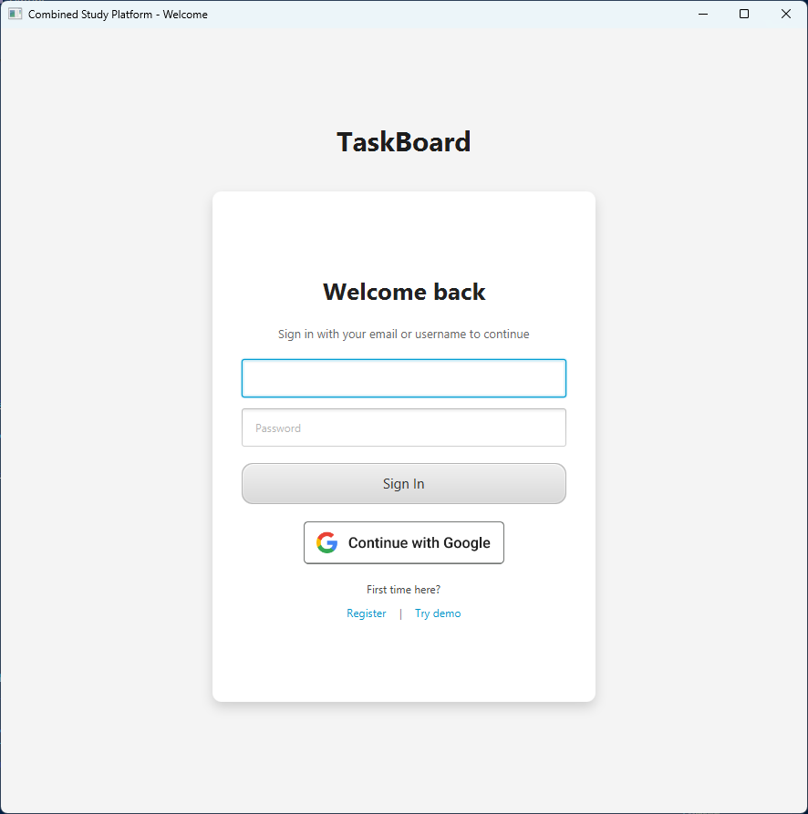
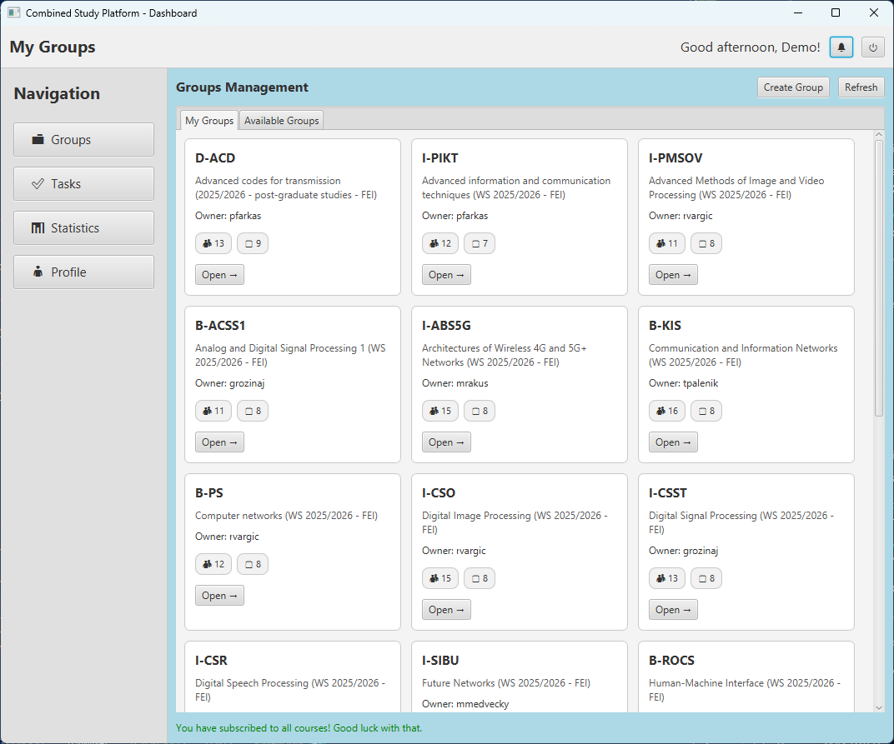
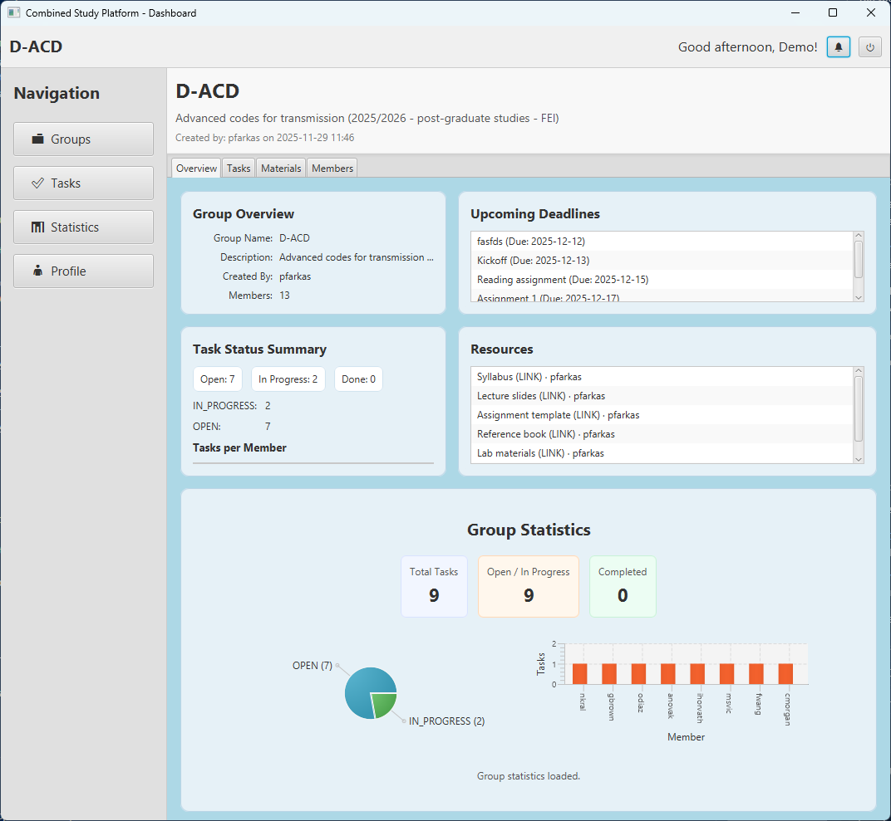
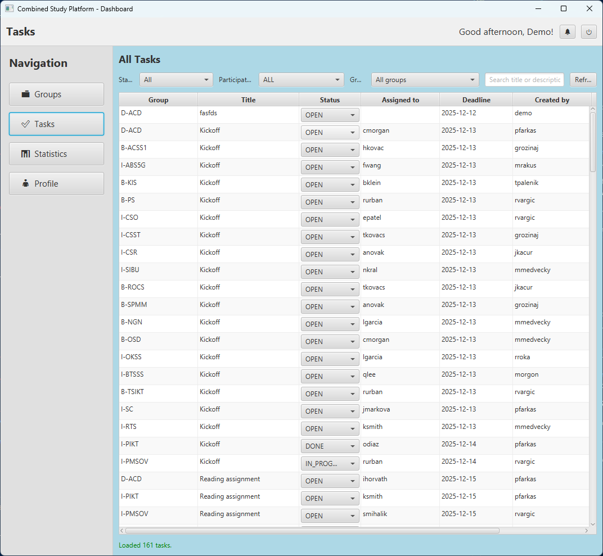
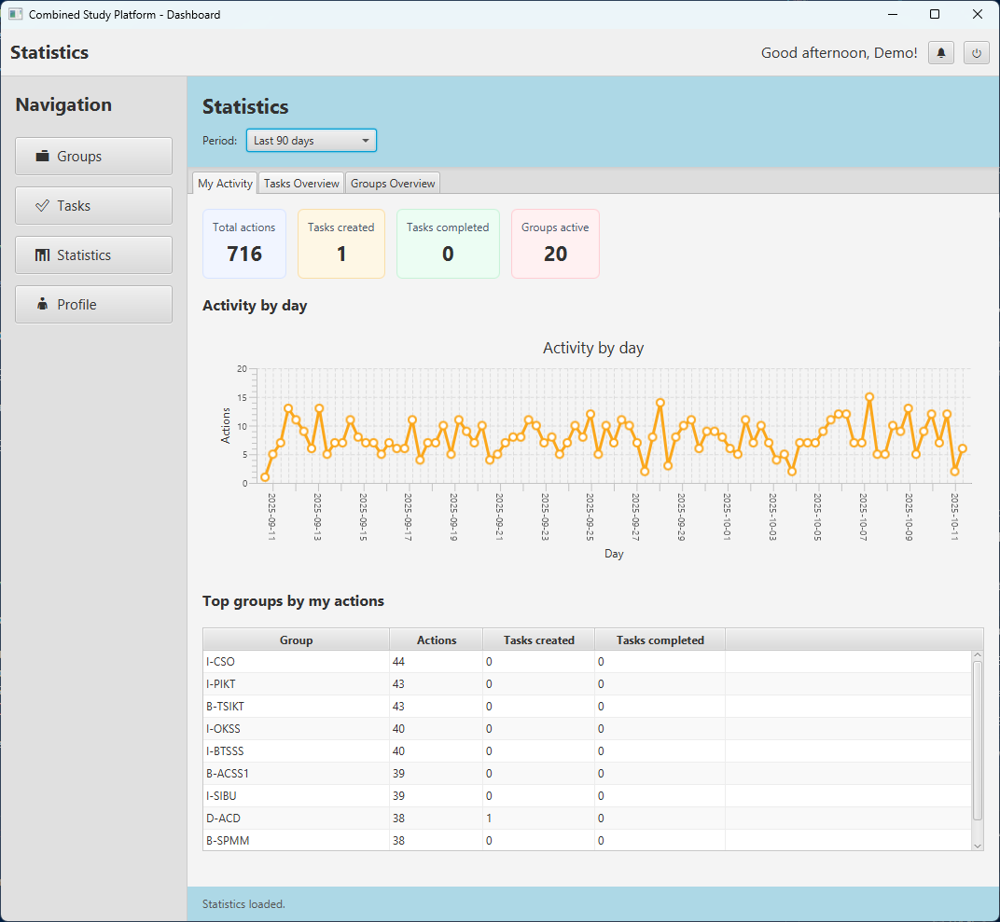
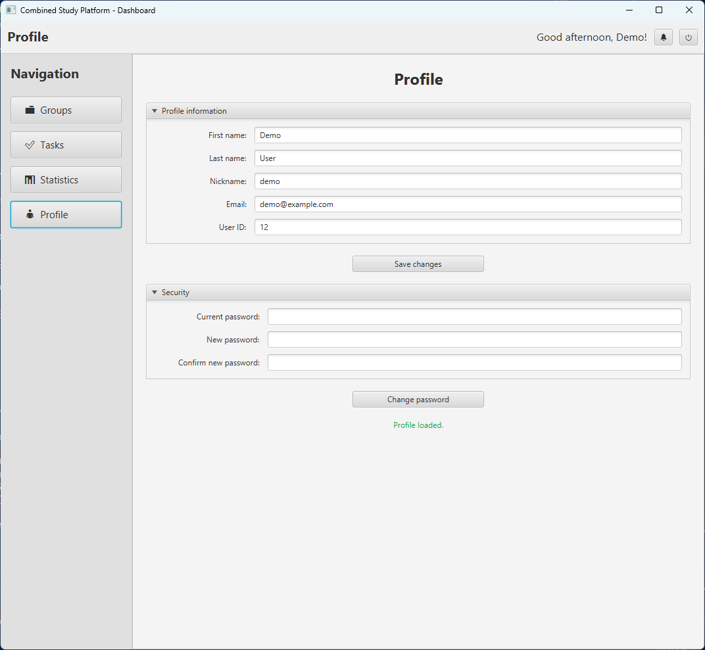
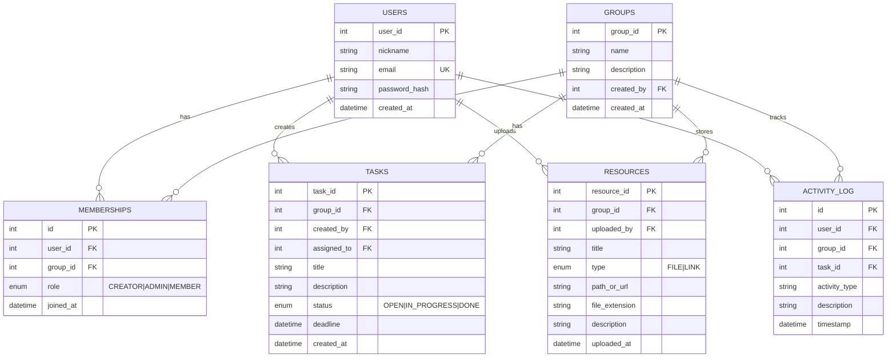

<div align="center">

# TaskBoard

**Task manager for study groups.** JavaFX desktop client, Spring Boot backend.

Semester project for *Tvorba softvéru v IKT*. Weekly exercises: [B-TSIKT](https://github.com/dmitthedazed/B-TSIKT).

[](https://github.com/dmitthedazed/B-TSIKT_Semestralne-Zadanie/actions/workflows/ci.yml)


<p align="center"><b>English</b> · <a href="README.sk.md">Slovenčina</a></p>








</div>

## Features

- **Groups** with three roles: Creator, Admin, Member. Members can be added by email.
- **Tasks** with an assignee, a deadline and a status (Open → In Progress → Done). Each user has a personal task list.
- **Resources**: files and links, kept per group.
- **Statistics**: group activity, task completion charts and a 90-day activity history.
- **Live updates** over WebSocket (STOMP), so changes show up in other clients without a refresh.
- **Auth**: JWT and Google OAuth 2.0 sign-in; passwords are hashed with BCrypt.
- **CI**: GitHub Actions runs `mvn -B verify` on pushes and pull requests.

## Stack

| Layer | Technology |
|:---|:---|
| Frontend | JavaFX 21, FXML, CSS |
| Backend | Spring Boot 3.3.1, Spring Security |
| Database | SQLite (prod), H2 in-memory (demo) |
| Auth | JWT, Google OAuth 2.0 |
| Real-time | WebSocket (STOMP) |
| Build | Maven, multi-module (`backend`, `frontend`) |

## Install

Needs [Java 21](https://adoptium.net/) and [Maven 3.8+](https://maven.apache.org/download.cgi). From the repository root:

```sh
mvn clean install
```

## Run

Backend (terminal 1), then frontend (terminal 2):

```sh
mvn -pl backend spring-boot:run
```

```sh
mvn -pl frontend javafx:run
```

> [!NOTE]
> The SQLite file is created on first run.

### Demo mode

H2 in-memory database with seeded data, backend on port `8081`:

```sh
mvn -pl backend spring-boot:run -Dspring-boot.run.profiles=demo
```

```sh
mvn -pl frontend javafx:run -DAPI_BASE_URL=http://localhost:8081/api
```

Click **Try demo** on the login screen, or sign in manually:

| Email | Password |
|:---|:---|
| `demo@example.com` | `demo123` |

| Service | Port |
|:---|:---:|
| Backend (production) | `8080` |
| Backend (demo) | `8081` |

### Tests

```sh
mvn test
```

Backend only: `mvn -pl backend test`.

## Architecture

```
JavaFX client                          Spring Boot server
┌─────────────────────┐   HTTP + JWT   ┌──────────────────────────────┐
│ FXML controllers    │ ─────────────► │ REST controllers + JWT filter│
│ ApiService          │                │ Services → Repositories (JPA)│
│ WebSocket client    │ ◄───────────── │ WebSocketNotificationService │──► SQLite
└─────────────────────┘     STOMP      └──────────────────────────────┘
```

<details>
<summary><b>Data model</b></summary>



</details>

<details>
<summary><b>Project structure</b></summary>

```
├── backend/                 # Spring Boot
│   └── src/main/
│       ├── java/com/combined/backend/
│       │   ├── config/      # Security, WebSocket
│       │   ├── controller/  # REST endpoints
│       │   ├── dto/
│       │   ├── model/       # JPA entities
│       │   ├── repository/
│       │   └── service/
│       └── resources/       # application.properties, application-demo.properties
├── frontend/                # JavaFX
│   └── src/main/
│       ├── java/            # Controllers, services
│       └── resources/       # fxml/, css/, img/
├── docs/screenshots/
└── pom.xml                  # Parent POM
```

</details>

## API

All endpoints except `/api/auth/*` require a JWT.

<details>
<summary><b>Auth and users</b></summary>

| Method | Endpoint | Description |
|:---:|:---|:---|
| `POST` | `/api/auth/register` | Register |
| `POST` | `/api/auth/login` | Log in, get JWT |
| `GET` | `/api/users/me` | Current user |
| `PUT` | `/api/users/me` | Update profile |
| `POST` | `/api/users/me/change-password` | Change password |

</details>

<details>
<summary><b>Groups and memberships</b></summary>

| Method | Endpoint | Description |
|:---:|:---|:---|
| `GET` | `/api/groups` | All groups |
| `GET` | `/api/groups/my` | My groups |
| `GET` | `/api/groups/available` | Joinable groups |
| `POST` | `/api/groups` | Create group |
| `GET` | `/api/groups/{id}` | Group details |
| `POST` | `/api/memberships/join/{groupId}` | Join |
| `POST` | `/api/memberships/leave/{groupId}` | Leave |
| `GET` | `/api/memberships/group/{groupId}/members` | List members |
| `POST` | `/api/memberships/group/{groupId}/add-member` | Add member |
| `POST` | `/api/memberships/group/{groupId}/add-member-by-email` | Add by email |
| `PUT` | `/api/memberships/group/{groupId}/update-role` | Change role |
| `DELETE` | `/api/memberships/group/{groupId}/remove-member` | Remove member |

</details>

<details>
<summary><b>Tasks</b></summary>

| Method | Endpoint | Description |
|:---:|:---|:---|
| `POST` | `/api/tasks` | Create |
| `GET` | `/api/tasks/group/{id}` | Group tasks |
| `GET` | `/api/tasks/my` | My tasks |
| `PUT` | `/api/tasks/{id}` | Update |
| `DELETE` | `/api/tasks/{id}` | Delete |

</details>

<details>
<summary><b>Resources</b></summary>

| Method | Endpoint | Description |
|:---:|:---|:---|
| `GET` | `/api/resources/group/{id}` | List |
| `POST` | `/api/resources` | Create (link) |
| `POST` | `/api/resources/upload` | Upload file |
| `PUT` | `/api/resources/{id}` | Update |
| `DELETE` | `/api/resources/{id}` | Delete |
| `GET` | `/api/resources/{id}/download` | Download |

</details>

<details>
<summary><b>Statistics and activity</b></summary>

| Method | Endpoint | Description |
|:---:|:---|:---|
| `GET` | `/api/group-stats/{groupId}` | Group statistics |
| `GET` | `/api/activity-logs/user/me` | My activity |
| `GET` | `/api/activity-logs/group/{groupId}` | Group activity |

</details>

### WebSocket

STOMP topics: `/topic/group/{groupId}` and `/topic/user/{userId}`. Each message carries a `type` and a `message`.

| Type | Meaning |
|:---|:---|
| `TASK_CREATED` | Task added |
| `TASK_UPDATED`, `TASK_UPDATE` | Task changed |
| `TASK_DELETED` | Task removed |
| `RESOURCE_UPLOADED` | New material |
| `USER_JOINED` | New member |

## Security

| Area | Implementation |
|:---|:---|
| Authentication | JWT with configurable expiration, Google OAuth 2.0 |
| Passwords | BCrypt |
| Authorization | Role-based: CREATOR > ADMIN > MEMBER |
| CSRF | Disabled (stateless API) |
| Identity | `@AuthenticationPrincipal` prevents spoofing |

- **Creator**: full control, cannot be removed or demoted.
- **Admin**: manages members (except the creator), resources and tasks.
- **Member**: views resources, manages own tasks.

## AI assistance

GitHub Copilot and Claude (Anthropic) were used for boilerplate and DTOs, debugging, review suggestions, tests and design discussion. The generated code was reviewed, tested and edited by hand.

---

<div align="center">

Dmytrii Savin ([@dmitthedazed](https://github.com/dmitthedazed)). Licensed under the [MIT License](LICENSE).

</div>
