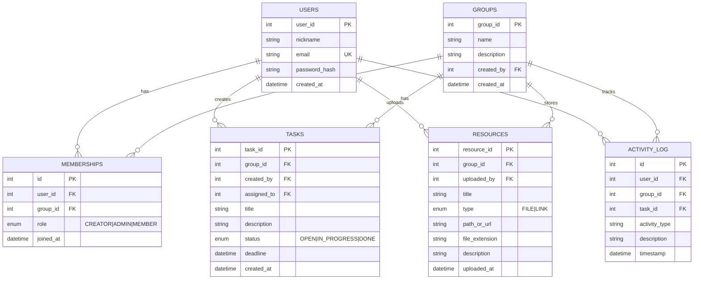

<div align="center">

# 📚 TaskBoard

### Collaborative Task Platform

*A modern JavaFX desktop client + Spring Boot backend for collaborative study groups*

[](https://github.com/dmitthedazed/B-TSIKT_Semestralne-Zadanie/actions/workflows/ci.yml)

[](https://openjdk.org/)
[](https://spring.io/projects/spring-boot)
[](https://openjfx.io/)
[](https://www.sqlite.org/)
[](https://developers.google.com/identity)
[](LICENSE)

🇬🇧 **English** | 🇸🇰 [Slovenčina](README.sk.md)

[Features](#-features) •
[Screenshots](#-screenshots) •
[Tech Stack](#️-tech-stack) •
[Installation](#-installation) •
[Usage](#-usage) •
[Architecture](#️-architecture) •
[API](#-api-reference) •
[WebSocket](#websocket-events) •
[Project Structure](#-project-structure) •
[Security](#-security) •
[Testing](#testing) •
[AI Assistance](#-ai-assistance) •
[Author](#-author)

</div>

---

## ✨ Features

<table>
<tr>
<td width="50%">

### 👥 Group Collaboration
- Create and manage study groups
- Role-based access (Creator, Admin, Member)
- Invite members by email
- Real-time member activity

</td>
<td width="50%">

### ✅ Task Management
- Create, assign, and track tasks
- Status tracking (Open → In Progress → Done)
- Deadline management
- Personal task dashboard

</td>
</tr>
<tr>
<td width="50%">

### 📁 Resource Sharing
- Upload files and share links
- Organized by study groups
- Download and manage materials
- File type support

</td>
<td width="50%">

### 📊 Analytics & Statistics
- Group activity statistics
- Task completion charts
- 90-day activity history
- Visual progress tracking

</td>
</tr>
<tr>
<td width="50%">

### 🔐 Security
- JWT-based authentication
- **Google OAuth 2.0** sign-in
- Secure password hashing
- Role-based permissions
- Protected API endpoints

</td>
</tr>
<tr>
<td width="50%">

### 🚀 CI/CD Pipeline
- Automated testing with GitHub Actions
- Build verification on every push
- Code quality checks
- Continuous integration

</td>
<td width="50%">

### ⚡ Real-time Updates
- WebSocket notifications
- Live task updates
- Member activity alerts
- Instant sync across clients

</td>
</tr>
</table>

---

## 📸 Screenshots

<div align="center">


| Login Screen | Dashboard | Group Detail |
|:---:|:---:|:---:|
|  |  |  |

| Tasks View | Statistics | Profile |
|:---:|:---:|:---:|
|  |  |  |

</div>

---

## 🛠️ Tech Stack

<div align="center">

| Layer | Technology |
|:---:|:---|
| **Frontend** | JavaFX 21, FXML, CSS |
| **Backend** | Spring Boot 3.3.1, Spring Security |
| **Database** | SQLite (prod), H2 (demo) |
| **Auth** | JWT (JSON Web Tokens) |
| **Real-time** | WebSocket (STOMP) |
| **Build** | Maven (multi-module) |

</div>

---

## 📦 Installation

### Prerequisites

- **Java 21** or higher ([Download](https://adoptium.net/))
- **Maven 3.8+** ([Download](https://maven.apache.org/download.cgi))
- Git

### Quick Start

```bash
# Clone the repository
git clone https://github.com/dmitthedazed/B-TSIKT_Semestralne-Zadanie.git
cd B-TSIKT_Semestralne-Zadanie

# Build the project
mvn clean install

# Start the backend (Terminal 1)
mvn -pl backend spring-boot:run

# Start the frontend (Terminal 2)
mvn -pl frontend javafx:run
```

> 📝 **Note:** The SQLite database file is auto-created on first run.

---

## 🚀 Usage

### 🎮 Demo Mode

Try the app instantly with pre-seeded data 

```bash
# Start demo backend (H2 in-memory, port 8081)
cd backend
mvn spring-boot:run "-Dspring-boot.run.profiles=demo"

# Start frontend pointing to demo
mvn -pl frontend javafx:run -DAPI_BASE_URL=http://localhost:8081/api
```

Or simply click **"Try Demo"** on the login screen!

| Demo Credentials |  |
|:---|:---|
| 📧 Email | `demo@example.com` |
| 🔑 Password | `demo123` |

### Default Ports

| Service | Port |
|:---:|:---:|
| Backend (Production) | `8080` |
| Backend (Demo) | `8081` |

---

## 🏗️ Architecture

```
┌─────────────────────────────────────────────────────────────┐
│                        CLIENT (JavaFX)                       │
├─────────────────────────────────────────────────────────────┤
│  Controllers (FXML)  │  ApiService  │  WebSocket Client     │
│         ↓            │      ↓       │         ↓             │
│       Views          │  HTTP/JWT    │    STOMP Messages     │
└──────────────────────┴──────────────┴───────────────────────┘
                              │
                              ▼
┌─────────────────────────────────────────────────────────────┐
│                      SERVER (Spring Boot)                    │
├─────────────────────────────────────────────────────────────┤
│  REST Controllers  │  WebSocket Handler  │  Security Filter │
│         ↓          │         ↓           │        ↓         │
│     Services       │    Notification     │   JWT Validator  │
│         ↓          │      Service        │                  │
│   Repositories     │                     │                  │
│         ↓          │                     │                  │
│    JPA/Hibernate   │                     │                  │
│         ↓          │                     │                  │
│      SQLite        │                     │                  │
└─────────────────────────────────────────────────────────────┘
```

### 📊 Data Model



---

## 📡 API Reference

<details>
<summary><b>🔐 Authentication</b></summary>

| Method | Endpoint | Description |
|:---:|:---|:---|
| `POST` | `/api/auth/register` | Register new user |
| `POST` | `/api/auth/login` | Login & get JWT |

</details>

<details>
<summary><b>👤 Users</b></summary>

| Method | Endpoint | Description |
|:---:|:---|:---|
| `GET` | `/api/users/me` | Get current user |
| `PUT` | `/api/users/me` | Update profile |
| `POST` | `/api/users/me/change-password` | Change password |

</details>

<details>
<summary><b>👥 Groups</b></summary>

| Method | Endpoint | Description |
|:---:|:---|:---|
| `GET` | `/api/groups` | List all groups |
| `GET` | `/api/groups/my` | List my groups |
| `GET` | `/api/groups/available` | List joinable groups |
| `POST` | `/api/groups` | Create group |
| `GET` | `/api/groups/{id}` | Get group details |

</details>

<details>
<summary><b>🤝 Memberships</b></summary>

| Method | Endpoint | Description |
|:---:|:---|:---|
| `POST` | `/api/memberships/join/{groupId}` | Join group |
| `POST` | `/api/memberships/leave/{groupId}` | Leave group |
| `GET` | `/api/memberships/group/{groupId}/members` | List members |
| `POST` | `/api/memberships/group/{groupId}/add-member` | Add member |
| `POST` | `/api/memberships/group/{groupId}/add-member-by-email` | Add by email |
| `PUT` | `/api/memberships/group/{groupId}/update-role` | Change role |
| `DELETE` | `/api/memberships/group/{groupId}/remove-member` | Remove member |

</details>

<details>
<summary><b>✅ Tasks</b></summary>

| Method | Endpoint | Description |
|:---:|:---|:---|
| `POST` | `/api/tasks` | Create task |
| `GET` | `/api/tasks/group/{id}` | List group tasks |
| `GET` | `/api/tasks/my` | List my tasks |
| `PUT` | `/api/tasks/{id}` | Update task |
| `DELETE` | `/api/tasks/{id}` | Delete task |

</details>

<details>
<summary><b>📁 Resources</b></summary>

| Method | Endpoint | Description |
|:---:|:---|:---|
| `GET` | `/api/resources/group/{id}` | List resources |
| `POST` | `/api/resources` | Create resource (link) |
| `POST` | `/api/resources/upload` | Upload file |
| `PUT` | `/api/resources/{id}` | Update resource |
| `DELETE` | `/api/resources/{id}` | Delete resource |
| `GET` | `/api/resources/{id}/download` | Download file |

</details>

<details>
<summary><b>📊 Statistics & Activity</b></summary>

| Method | Endpoint | Description |
|:---:|:---|:---|
| `GET` | `/api/group-stats/{groupId}` | Group statistics |
| `GET` | `/api/activity-logs/user/me` | My activity |
| `GET` | `/api/activity-logs/group/{groupId}` | Group activity |

</details>

---

## WebSocket Events

Real-time notifications via STOMP over WebSocket:

| Event | Description |
|:---|:---|
| `task.created` | New task added |
| `task.updated` | Task modified |
| `task.deleted` | Task removed |
| `task.status` | Status changed |
| `resource.added` | New material uploaded |
| `member.joined` | New member joined |
| `member.role` | Role changed |

---

## 📁 Project Structure

```
B-TSIKT_Semestralne-Zadanie
├──  backend/                    # Spring Boot backend
│   ├──  src/main/java/com/combined/backend/
│   │   ├──  config/             # Security, WebSocket config
│   │   ├──  controller/         # REST endpoints
│   │   ├──  dto/                # Data transfer objects
│   │   ├──  model/              # JPA entities
│   │   ├──  repository/         # Data access layer
│   │   ├──  service/            # Business logic
│   │   └──  BackendApplication.java
│   └──  src/main/resources/
│       ├──  application.properties
│       └──  application-demo.properties
├──  frontend/                   # JavaFX client
│   ├──  src/main/java/          # Controllers & services
│   └──  src/main/resources/
│       ├──  fxml/               # UI layouts
│       ├──  css/                # Stylesheets
│       └──  img/                # Images
├──  pom.xml                     # Parent POM
└──  README.md
```

---

## 🔒 Security

| Feature | Implementation |
|:---|:---|
| **Authentication** | JWT tokens with configurable expiration |
| **Password Storage** | BCrypt hashing |
| **Authorization** | Role-based (CREATOR > ADMIN > MEMBER) |
| **API Protection** | All endpoints require valid JWT |
| **CSRF** | Disabled (stateless API) |
| **User Identity** | `@AuthenticationPrincipal` prevents spoofing |

### Access Control Rules

- ✅ **Creator**: Full control, cannot be removed/demoted
- ✅ **Admin**: Manage members (except creator), manage resources/tasks
- ✅ **Member**: View resources, manage own tasks

---

## Testing

```bash
# Run all tests
mvn test

# Run backend tests only
mvn -pl backend test

# Run with coverage report
mvn -pl backend test jacoco:report
```

##  AI Assistance

This project was developed with the assistance of AI tools, specifically **GitHub Copilot** and **Claude** (Anthropic). AI was used to:

| Area | How AI Helped |
|:---|:---|
| **Code Generation** | Accelerating boilerplate code, DTOs, and repetitive patterns |
| **Debugging** | Identifying issues and suggesting fixes for complex bugs |
| **Code Review** | Suggesting improvements for code quality and best practices |
| **Testing** | Helping write unit and integration tests |
| **Architecture** | Discussing design patterns and architectural decisions |

> ⚠️ **Important:** All AI-generated code was carefully reviewed, tested, and modified.AI served as a productivity tool, not a replacement for understanding and critical thinking.

---

## 👨‍💻 Author

<div align="center">

**Dmitrii Savin**

[](https://github.com/dmitthedazed)

*Semester Project — B-TSIKT*

</div>

---

## 📄 License

This project is licensed under the MIT License - see the [LICENSE](LICENSE) file for details.

---

