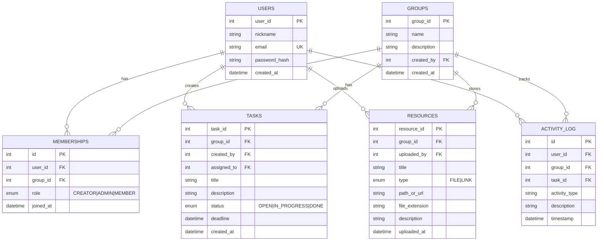

<div align="center">

# TaskBoard

Správca úloh pre študijné skupiny. Desktopový klient v JavaFX, backend v Spring Boot.

[](https://github.com/dmitthedazed/B-TSIKT_Semestralne-Zadanie/actions/workflows/ci.yml)


[](LICENSE)

🇬🇧 [English](README.md) · 🇸🇰 **Slovenčina**


</div>

## Funkcie

- **Skupiny** s tromi rolami: Tvorca, Admin, Člen. Členov možno pridať e-mailom.
- **Úlohy** s riešiteľom, termínom a stavom (Otvorená → Prebieha → Hotovo). Každý používateľ má osobný zoznam úloh.
- **Zdroje**: súbory a odkazy, uložené po skupinách.
- **Štatistiky**: aktivita skupiny, grafy dokončených úloh a 90-dňová história aktivít.
- **Živé aktualizácie** cez WebSocket (STOMP), zmeny sa v ostatných klientoch zobrazia bez obnovenia.
- **Prihlásenie**: JWT a Google OAuth 2.0; heslá sa hashujú cez BCrypt.
- **CI**: GitHub Actions spúšťa `mvn -B verify` pri pushi a pull requeste.

## Technológie

| Vrstva | Technológia |
|:---|:---|
| Frontend | JavaFX 21, FXML, CSS |
| Backend | Spring Boot 3.3.1, Spring Security |
| Databáza | SQLite (prod), H2 in-memory (demo) |
| Autentifikácia | JWT, Google OAuth 2.0 |
| Reálny čas | WebSocket (STOMP) |
| Build | Maven, multi-modul (`backend`, `frontend`) |

## Inštalácia

Potrebné: [Java 21](https://adoptium.net/) a [Maven 3.8+](https://maven.apache.org/download.cgi). V koreňovom adresári repozitára:

```sh
mvn clean install
```

## Spustenie

Backend (terminál 1), potom frontend (terminál 2):

```sh
mvn -pl backend spring-boot:run
```

```sh
mvn -pl frontend javafx:run
```

> [!NOTE]
> Súbor SQLite sa vytvorí pri prvom spustení.

### Demo režim

H2 in-memory databáza s predvyplnenými dátami, backend na porte `8081`:

```sh
mvn -pl backend spring-boot:run -Dspring-boot.run.profiles=demo
```

```sh
mvn -pl frontend javafx:run -DAPI_BASE_URL=http://localhost:8081/api
```

Kliknite na **Try demo** na prihlasovacej obrazovke alebo sa prihláste ručne:

| E-mail | Heslo |
|:---|:---|
| `demo@example.com` | `demo123` |

| Služba | Port |
|:---|:---:|
| Backend (produkcia) | `8080` |
| Backend (demo) | `8081` |

### Testy

```sh
mvn test
```

Iba backend: `mvn -pl backend test`.

## Architektúra

```
Klient JavaFX                          Server Spring Boot
┌─────────────────────┐   HTTP + JWT   ┌──────────────────────────────┐
│ FXML controllery    │ ─────────────► │ REST controllery + JWT filter│
│ ApiService          │                │ Services → Repositories (JPA)│
│ WebSocket klient    │ ◄───────────── │ WebSocketNotificationService │──► SQLite
└─────────────────────┘     STOMP      └──────────────────────────────┘
```

<details>
<summary><b>Dátový model</b></summary>



</details>

<details>
<summary><b>Štruktúra projektu</b></summary>

```
├── backend/                 # Spring Boot
│   └── src/main/
│       ├── java/com/combined/backend/
│       │   ├── config/      # Security, WebSocket
│       │   ├── controller/  # REST endpointy
│       │   ├── dto/
│       │   ├── model/       # JPA entity
│       │   ├── repository/
│       │   └── service/
│       └── resources/       # application.properties, application-demo.properties
├── frontend/                # JavaFX
│   └── src/main/
│       ├── java/            # Controllery, služby
│       └── resources/       # fxml/, css/, img/
├── docs/screenshots/
└── pom.xml                  # Rodičovský POM
```

</details>

## API

Všetky endpointy okrem `/api/auth/*` vyžadujú JWT.

<details>
<summary><b>Autentifikácia a používatelia</b></summary>

| Metóda | Endpoint | Popis |
|:---:|:---|:---|
| `POST` | `/api/auth/register` | Registrácia |
| `POST` | `/api/auth/login` | Prihlásenie, získanie JWT |
| `GET` | `/api/users/me` | Aktuálny používateľ |
| `PUT` | `/api/users/me` | Úprava profilu |
| `POST` | `/api/users/me/change-password` | Zmena hesla |

</details>

<details>
<summary><b>Skupiny a členstvá</b></summary>

| Metóda | Endpoint | Popis |
|:---:|:---|:---|
| `GET` | `/api/groups` | Všetky skupiny |
| `GET` | `/api/groups/my` | Moje skupiny |
| `GET` | `/api/groups/available` | Skupiny na pripojenie |
| `POST` | `/api/groups` | Vytvorenie skupiny |
| `GET` | `/api/groups/{id}` | Detail skupiny |
| `POST` | `/api/memberships/join/{groupId}` | Pripojenie |
| `POST` | `/api/memberships/leave/{groupId}` | Opustenie |
| `GET` | `/api/memberships/group/{groupId}/members` | Zoznam členov |
| `POST` | `/api/memberships/group/{groupId}/add-member` | Pridanie člena |
| `POST` | `/api/memberships/group/{groupId}/add-member-by-email` | Pridanie e-mailom |
| `PUT` | `/api/memberships/group/{groupId}/update-role` | Zmena roly |
| `DELETE` | `/api/memberships/group/{groupId}/remove-member` | Odstránenie člena |

</details>

<details>
<summary><b>Úlohy</b></summary>

| Metóda | Endpoint | Popis |
|:---:|:---|:---|
| `POST` | `/api/tasks` | Vytvorenie |
| `GET` | `/api/tasks/group/{id}` | Úlohy skupiny |
| `GET` | `/api/tasks/my` | Moje úlohy |
| `PUT` | `/api/tasks/{id}` | Úprava |
| `DELETE` | `/api/tasks/{id}` | Zmazanie |

</details>

<details>
<summary><b>Zdroje</b></summary>

| Metóda | Endpoint | Popis |
|:---:|:---|:---|
| `GET` | `/api/resources/group/{id}` | Zoznam |
| `POST` | `/api/resources` | Vytvorenie (odkaz) |
| `POST` | `/api/resources/upload` | Nahratie súboru |
| `PUT` | `/api/resources/{id}` | Úprava |
| `DELETE` | `/api/resources/{id}` | Zmazanie |
| `GET` | `/api/resources/{id}/download` | Stiahnutie |

</details>

<details>
<summary><b>Štatistiky a aktivita</b></summary>

| Metóda | Endpoint | Popis |
|:---:|:---|:---|
| `GET` | `/api/group-stats/{groupId}` | Štatistiky skupiny |
| `GET` | `/api/activity-logs/user/me` | Moja aktivita |
| `GET` | `/api/activity-logs/group/{groupId}` | Aktivita skupiny |

</details>

### WebSocket

STOMP témy: `/topic/group/{groupId}` a `/topic/user/{userId}`. Každá správa obsahuje `type` a `message`.

| Typ | Význam |
|:---|:---|
| `TASK_CREATED` | Úloha pridaná |
| `TASK_UPDATED`, `TASK_UPDATE` | Úloha zmenená |
| `TASK_DELETED` | Úloha odstránená |
| `RESOURCE_UPLOADED` | Nový materiál |
| `USER_JOINED` | Nový člen |

## Bezpečnosť

| Oblasť | Implementácia |
|:---|:---|
| Autentifikácia | JWT s konfigurovateľnou expiráciou, Google OAuth 2.0 |
| Heslá | BCrypt |
| Autorizácia | Podľa rolí: CREATOR > ADMIN > MEMBER |
| CSRF | Vypnuté (stateless API) |
| Identita | `@AuthenticationPrincipal` zabraňuje podvrhnutiu |

- **Tvorca**: plná kontrola, nemôže byť odstránený ani degradovaný.
- **Admin**: spravuje členov (okrem tvorcu), zdroje a úlohy.
- **Člen**: zobrazuje zdroje, spravuje vlastné úlohy.

## Použitie AI

GitHub Copilot a Claude (Anthropic) sa použili na boilerplate a DTO, ladenie, návrhy pri revízii, testy a diskusiu o návrhu. Vygenerovaný kód som prešiel, otestoval a upravil ručne.

## Autor

Dmitrii Savin ([@dmitthedazed](https://github.com/dmitthedazed)), semestrálny projekt.

## Licencia

[MIT](LICENSE)
